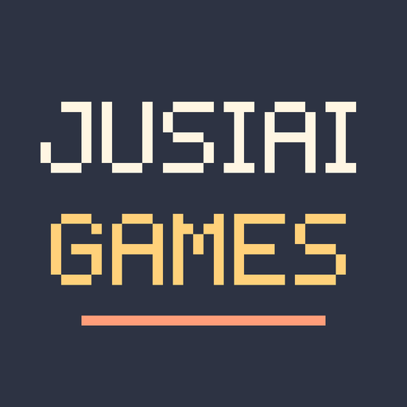

  

<h1 align="center">JUSIAI GAMES</h1>

小さな水槽で泳ぐ、ひとりのゲーム開発スタジオ

  <a href="./README.md">한국어</a> · <a href="./README.en.md">English</a> · <b>日本語</b>

---

## 紹介

**JUSIAI GAMES**は、企画からアート、開発までをひとりで手がけるゲーム開発スタジオです。

ブランドは小さな水槽ひとつから始まりました。マスコットは、ライムグリーンの水草のあいだを泳ぐ黄色いグッピーです。グッピーは小さな水槽の中でも休まず泳ぎ続けます。私たちも小さく作り、こまめに見せ、着実に前へ進んでいきます。

## 私たちの進め方

- **小さく作る。** ひとりでも最後まで作り切れる規模のゲームを作ります。
- **こまめに見せる。** 完成前の過程も開発ブログで公開します。
- **着実に進む。** 一度に大きく跳ぶより、毎日少しずつ泳ぎます。

## 開発ブログ

**https://jusiai-games.github.io**

- 制作中のゲームの開発過程と、その中で下した決定
- ゲームデザイン、アート、コードから学んだこと
- ひとりでスタジオを運営する中での出来事

このリポジトリは開発ブログサイトのソースコードです。

## お問い合わせ

- メール: jusiai.games@gmail.com
- GitHub: https://github.com/jusiai-games

ゲームに関するお問い合わせ、コラボレーションのご提案、バグ報告など、お気軽にご連絡ください。

---

© JUSIAI GAMES

